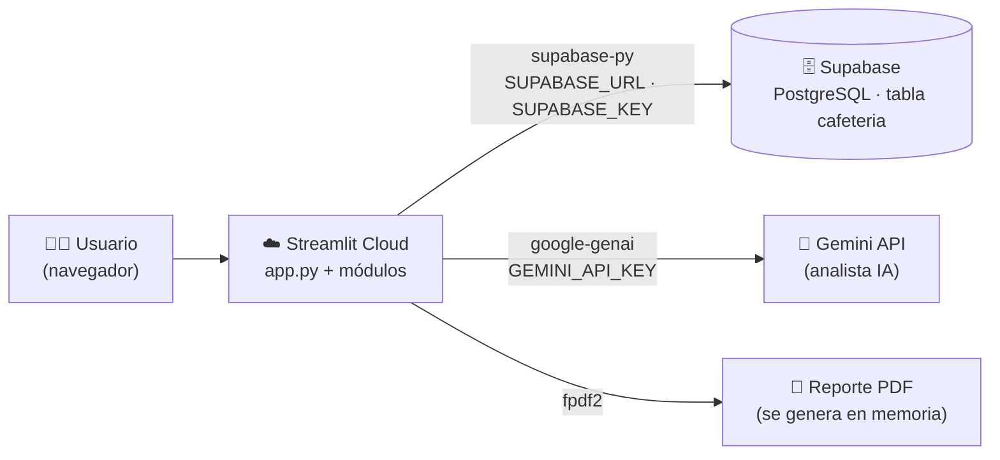

<div align="center">

# ☕ Cafetería Universitaria
### Captura y análisis estadístico de clientes · 7:00 – 11:00 AM

[](https://streamlit.io)
[](https://www.python.org)
[](https://supabase.com)
[](https://py-pdf.github.io/fpdf2/)
[](https://ai.google.dev)


**Repositorio:** [github.com/GGRAFSS/cafeteria-app](https://github.com/GGRAFSS/cafeteria-app)

</div>

Sistema web desarrollado en **Python + Streamlit** para **capturar, almacenar y analizar** datos de clientes de una cafetería universitaria en horario matutino (**7:00 AM – 11:00 AM**). Los datos viven en **Supabase (PostgreSQL en la nube)** y la app se publica en **Streamlit Community Cloud**, así que el usuario final **no instala nada**.

El proyecto forma parte de la asignatura **Modelos Estadísticos para el Aprendizaje Automático y Ciencia de Datos** y cubre las **4 unidades del temario**, desde la estadística descriptiva hasta el análisis bayesiano, e incluye un **reporte PDF de 10 capítulos** que se genera desde la propia app.

---

## 🎯 Características principales

| | Característica | Qué hace |
|---|---|---|
| 📝 | **Captura validada** | Formulario con validaciones de rango y catálogo que escribe directo en Supabase. |
| 📋 | **Gestión de registros** | Tabla paginada, detección y eliminación de filas con nulos, y recarga en caliente. |
| 📊 | **Estadística descriptiva (U1)** | Tendencia, dispersión y forma, KPIs, tablas de frecuencia, histogramas, boxplots, barras, outliers por IQR, **media ponderada** y **matriz de correlación**. |
| 📈 | **Distribuciones (U2)** | Ajuste Exponencial / Normal / Poisson, pruebas **KS**, **Q-Q plots** y simulaciones de apoyo (Bernoulli, Binomial, Geométrica, Hipergeométrica, Gamma). |
| 🧪 | **Hipótesis y modelos (U3)** | **t de Student**, **Mann-Whitney U**, **ANOVA** de un factor, **chi-cuadrado** (η² y V de Cramér), supuestos (Shapiro-Wilk, Levene), regresión logística, matriz de confusión y curva **ROC**. |
| 🎲 | **Bayes (U4)** | Calculadora de Bayes con **árbol de probabilidad**, Naive Bayes, Log-loss, Brier Score y prueba de **Friedman**. |
| 📄 | **Reporte PDF profesional** | Portada con logos, índice general, índice de figuras y de tablas, 10 capítulos, ~1 MB, descargable desde la barra lateral. |
| 🤖 | **Analista con IA** | Interpretaciones en lenguaje natural con **Gemini**; si falta la clave, la app usa textos de respaldo. |
| ☁️ | **100 % en la nube** | Sin instalación para el usuario final; cada `git push` a `main` redespliega la app. |

**Stack:** Streamlit · pandas · NumPy · SciPy · Matplotlib · scikit-learn · fpdf2 · google-genai · Supabase (PostgreSQL) · python-dotenv

---

## 🚀 Demo en vivo

> 🚧 **Aún no desplegada.** Cuando completes la sección **☁️ Despliegue en Streamlit Community Cloud**, sustituye `TU-APP` por la URL que te asigne la plataforma y actualiza este bloque.

[](https://TU-APP.streamlit.app)

| Dato | Valor |
|---|---|
| **Repositorio** | <https://github.com/GGRAFSS/cafeteria-app> |
| **Rama de despliegue** | `main` |
| **Archivo principal** | `app.py` |
| **Python** | `3.12` (fijado en `.python-version`) |

---

## 📊 Módulos del proyecto

La app se organiza en **6 pestañas** y **4 módulos estadísticos**, uno por unidad del temario:

| Unidad | Módulo(s) | Contenido | Pestaña |
|---|---|---|---|
| **1** — Estadística descriptiva | `stats_utils.py` · `viz_utils.py` | Captura, limpieza, tipos de variables, estadísticas descriptivas, KPIs, outliers IQR, media ponderada, matriz de correlación y visualización (histogramas, boxplots, barras, violín, heatmap). | 📊 **Estadísticas (U1)** |
| **2** — Distribuciones de probabilidad | `mod_distribuciones.py` | Ajuste **Exponencial**, **Normal** y **Poisson**, validación con **KS** y **Q-Q plots**, más simulaciones de apoyo (Bernoulli, Binomial, Geométrica, Hipergeométrica, Gamma). | 📈 **Distribuciones (U2)** |
| **3** — Pruebas de hipótesis y modelos | `mod_hipotesis.py` | **t de Student**, **Mann-Whitney U**, **ANOVA** de un factor, **chi-cuadrado**, supuestos (**Shapiro-Wilk**, **Levene**) y validación de modelos (regresión logística, matriz de confusión, **ROC**). | 🧪 **Hipótesis (U3)** |
| **4** — Estadística bayesiana | `mod_bayes.py` | **Calculadora de Bayes** con árbol de probabilidad, **Naive Bayes**, **Log-loss**, **Brier Score** y prueba de **Friedman** con validación cruzada. | 🎲 **Bayes (U4)** |

### Servicios transversales

| Servicio | Módulo | Detalle |
|---|---|---|
| **Capa de datos** | `data_manager.py` | Cliente oficial `supabase-py` cacheado con `st.cache_resource`, validaciones y limpieza. |
| **Reporte PDF** | `mod_reporte_est.py` | Documento de 10 capítulos (~30 páginas, 22 figuras, 30 tablas) con portada, índices y paginación en 3 pasadas. |
| **Analista IA** | `mod_ia_analista.py` | Interpretaciones con **Gemini** (`google-genai`) y caché en memoria con TTL de 1 hora. |
| **Carga inicial** | `seed_supabase.py` | Genera e inserta los **200 registros** simulados del dataset. |

### Las 6 pestañas de la app

`📝 Captura` · `📋 Registros` · `📊 Estadísticas (U1)` · `📈 Distribuciones (U2)` · `🧪 Hipótesis (U3)` · `🎲 Bayes (U4)`

> Además, la **barra lateral** concentra el estado de la conexión, el diccionario de variables y el botón **📄 Generar Reporte PDF**.

---

## 🗂️ Estructura del dataset

El dataset simula **200 clientes** con **9 variables** que combinan tipos cuantitativos y cualitativos (nominales, ordinales y binarios):

| # | Variable | Tipo | Clasificación estadística | Descripción |
|---|---|---|---|---|
| 1 | `ID_Cliente` | Entero | Cualitativa nominal | Identificador único del cliente |
| 2 | `Hora_Llegada` | Float | Cuantitativa continua | Hora decimal (`8.25` = 8:15 AM) |
| 3 | `Tiempo_Espera_Min` | Float | Cuantitativa continua | Minutos antes de ser atendido |
| 4 | `Tiempo_Servicio_Min` | Float | Cuantitativa continua | Minutos de atención del barista |
| 5 | `Tipo_Cliente` | Texto | Cualitativa nominal | Estudiante / Profesor / Administrativo |
| 6 | `Metodo_Pago` | Texto | Cualitativa nominal | Efectivo / Tarjeta / App (permite nulo) |
| 7 | `Consumo_Total_MXN` | Float | Cuantitativa continua | Monto gastado en pesos |
| 8 | `Satisfaccion_1_al_5` | Entero | Cualitativa ordinal | Calificación 1–5 (permite nulo) |
| 9 | `Es_Hora_Pico` | Texto | Cualitativa binaria | Sí / No (8:00–9:00 AM) |

**Notas del dataset**

- **Outliers inyectados intencionalmente** para practicar detección y limpieza: `300.0` en `Consumo_Total_MXN` y `-2.0` en `Tiempo_Servicio_Min` (este último lo rechaza la BD por la restricción `> 0`).
- Valores nulos permitidos en `Metodo_Pago` y `Satisfaccion_1_al_5`, gestionados por la capa de datos y el reporte.
- Tabla en Supabase: **`cafeteria`**.

---

## 🏗️ Arquitectura



```text
┌──────────────────────┐        ┌──────────────────────────┐        ┌──────────────────┐
│  Streamlit Cloud     │───────▶│  app.py + módulos        │───────▶│  Supabase (DB)   │
│  (frontend web)      │        │  (lógica estadística)    │        │  PostgreSQL      │
└──────────────────────┘        └──────────────────────────┘        └──────────────────┘
                                          │
                                          ├──▶  Gemini API (analista IA, opcional)
                                          └──▶  PDF en memoria (fpdf2) → st.download_button
```

| Componente | Tecnología |
|---|---|
| **Frontend + lógica** | Streamlit (Python) |
| **Base de datos** | Supabase (PostgreSQL en la nube, plan gratuito) |
| **Despliegue** | Streamlit Community Cloud (gratuito, conectado a GitHub) |
| **Reporte** | fpdf2 + Matplotlib (`Agg`) |
| **IA** | Google Gemini (`google-genai`) |

---

## 📁 Estructura del repositorio

```text
cafeteria_app/
├── .streamlit/
│   └── secrets.toml          ← credenciales (NO se sube a GitHub)
├── assets/
│   ├── logo_maestria_ia.png  ← logos institucionales del PDF
│   └── logo_tecnm_virtual.png
├── app.py                    ← interfaz Streamlit (6 pestañas)
├── data_manager.py           ← capa Supabase + validaciones + limpieza
├── stats_utils.py            ← descriptivas, KPIs, outliers IQR, media ponderada, correlación
├── viz_utils.py              ← histogramas, boxplots, barras, ajustes, violín, correlación, árbol bayesiano
├── mod_distribuciones.py     ← Unidad 2: Poisson, Q-Q, KS + simulaciones de apoyo
├── mod_hipotesis.py          ← Unidad 3: t, Mann-Whitney, ANOVA, chi-cuadrado, logística, ROC
├── mod_bayes.py              ← Unidad 4: Bayes, Naive Bayes, Friedman
├── mod_reporte_est.py        ← reporte PDF estadístico (portada, índices, 10 capítulos)
├── mod_ia_analista.py        ← analista con IA (Gemini) para interpretaciones
├── seed_supabase.py          ← script de carga inicial (200 registros)
├── .env.example              ← plantilla de variables para seed_supabase.py
├── requirements.txt          ← dependencias de la app
├── .python-version           ← fija Python 3.12 (Streamlit Cloud)
├── .gitignore                ← secretos, venv, caché, PDFs y scripts de prueba
└── README.md
```

> Los scripts de verificación `_smoke_*.py` y `_verify_*.py` viven **solo en local** (están en `.gitignore`) y no forman parte del despliegue; su uso se explica en la sección **🧪 Pruebas**.

---

## ⚙️ Instalación local

**Requisitos previos:** Python **3.12**, Git y un proyecto de Supabase (gratuito). Opcional: una **API key de Gemini** para el analista IA.

### 1. Clonar el repositorio

```bash
git clone https://github.com/GGRAFSS/cafeteria-app.git
cd cafeteria-app
```

### 2. Crear el entorno e instalar dependencias

**Windows (PowerShell):**

```powershell
python -m venv venv
.\venv\Scripts\Activate.ps1
pip install -r requirements.txt
```

**macOS / Linux:**

```bash
python3 -m venv venv
source venv/bin/activate
pip install -r requirements.txt
```

Dependencias declaradas en `requirements.txt`:

| Paquete | Versión | Para qué se usa |
|---|---|---|
| `streamlit` | `>=1.30,<2.0` | Interfaz web |
| `pandas` | `>=2.0,<3.0` | Manipulación de datos |
| `numpy` | `>=1.26,<3.0` | Cálculo numérico |
| `scipy` | `>=1.11,<2.0` | Pruebas estadísticas y distribuciones |
| `matplotlib` | `>=3.7,<4.0` | Gráficas y fuentes del PDF |
| `fpdf2` | `>=2.7,<3.0` | Generación del reporte PDF |
| `supabase` | `>=2.0` | Cliente de PostgreSQL en la nube |
| `scikit-learn` | `>=1.3` | Regresión logística, Naive Bayes, métricas |
| `google-genai` | `>=1.0,<4.0` | Analista con Gemini |
| `python-dotenv` | `>=1.0,<2.0` | Lectura del `.env` en `seed_supabase.py` |

### 3. Crear `.streamlit/secrets.toml`

```toml
SUPABASE_URL = "https://<tu-proyecto>.supabase.co"
SUPABASE_KEY = "<tu-anon-key>"
GEMINI_API_KEY = "<tu-api-key-de-google-ai-studio>"
```

> Este archivo está en `.gitignore`: **nunca** debe subirse al repositorio.

### 4. Ejecutar la app

```bash
streamlit run app.py
```

La app queda disponible en `http://localhost:8501`.

### 5. (Opcional) Cargar los 200 registros iniciales

`seed_supabase.py` **no** lleva credenciales en el código: las lee de un archivo `.env` (ignorado por Git).

**Windows (PowerShell):**

```powershell
Copy-Item .env.example .env
# edita .env y coloca tus credenciales
python seed_supabase.py
```

**macOS / Linux:**

```bash
cp .env.example .env
# edita .env y coloca tus credenciales
python seed_supabase.py
```

Contenido de `.env`:

```dotenv
SUPABASE_URL=https://<tu-proyecto>.supabase.co
SUPABASE_KEY=<tu-anon-key>
```

Si alguna de las dos variables falta, el script se detiene con un `ValueError` **antes** de crear el cliente o tocar la base de datos.

---

## ☁️ Despliegue en Streamlit Community Cloud

1. **Subir el código a GitHub** (`main`). Antes de hacer commit, confirma que `.streamlit/secrets.toml` **no** aparece en `git status` (debe estar ignorado).
2. Entra a <https://share.streamlit.io> con la cuenta de GitHub y elige **Create app** → **Deploy a public app from GitHub**.
3. Llena el formulario:
   - **Repository:** `GGRAFSS/cafeteria-app`
   - **Branch:** `main`
   - **Main file path:** `app.py`
   - **App URL:** la que prefieras (ej. `cafeteria-app-ggrafss`)
4. Abre **Advanced settings**:
   - **Python version:** `3.12` (coincide con el archivo `.python-version`).
   - **Secrets:** pega el bloque TOML completo (las 3 claves) y guarda.
5. **Deploy**. La primera instalación tarda ~3–5 min (scipy, matplotlib y scikit-learn son pesadas).
6. **Actualizaciones:** cada `git push` a `main` redespliega la app automáticamente.
7. **Reiniciar la app:**
   - Desde el dashboard: menú **⋮ → Reboot app**.
   - Desde la app abierta: **Manage app → ⋮ → Reboot app**.
   - Al **guardar un secret** (Manage app → Settings → Secrets → Save) la app se reinicia sola; si no ocurre, haz **Reboot app**.

### 🔐 Secrets requeridos

| Clave | Para qué se usa | Dónde se obtiene |
|---|---|---|
| `SUPABASE_URL` | Conexión a la base de datos | Supabase → Project Settings → API |
| `SUPABASE_KEY` | Conexión a la base de datos (anon key) | Supabase → Project Settings → API |
| `GEMINI_API_KEY` | Analista IA (pestaña 6) y textos del reporte | [Google AI Studio](https://aistudio.google.com/apikey) |

Sin `GEMINI_API_KEY` la app **no se rompe**: el módulo IA se desactiva solo y el reporte usa sus textos de respaldo.

### Secrets en Streamlit Cloud (paso a paso)

1. Abre tu app en <https://share.streamlit.io>.
2. **Manage app** (esquina inferior derecha) → **Settings**.
3. Pestaña **Secrets** y pega exactamente:

```toml
SUPABASE_URL = "https://<tu-proyecto>.supabase.co"
SUPABASE_KEY = "<tu-anon-key>"
GEMINI_API_KEY = "<tu-api-key>"
```

4. **Save** y espera el reinicio (o **Reboot app** manual).
5. Verifica en **Manage app → Logs** que no aparezcan `KeyError: 'SUPABASE_URL'` ni `KeyError: 'GEMINI_API_KEY'`.

### Notas técnicas del despliegue

- El PDF se construye **en memoria** (`pdf.output()` → `bytes`) y se entrega con `st.download_button`; no se escribe nada en disco.
- Las fuentes Unicode del PDF se toman de `matplotlib.get_data_path()/fonts/ttf` (DejaVu), disponibles también en el contenedor Linux de Streamlit Cloud.
- `matplotlib.use("Agg")` ya está forzado en `app.py`, así que no hay dependencias de GUI en el servidor.
- No se requiere `.streamlit/config.toml` ni archivos adicionales para producción.

### ✅ Checklist de despliegue

**Antes de hacer commit**

- [ ] `git status` **no** muestra `.streamlit/secrets.toml`.
- [ ] `git add -A --dry-run` no lista `_smoke_*.py`, `_verify_*.py` ni `reporte_*.pdf`.
- [ ] `requirements.txt` incluye `fpdf2` y `google-genai`.
- [ ] `assets/logo_maestria_ia.png` y `assets/logo_tecnm_virtual.png` están versionados.
- [ ] `mod_reporte_est.py` y `mod_ia_analista.py` están versionados.

**En Streamlit Cloud (Secrets)**

- [ ] `SUPABASE_URL`, `SUPABASE_KEY` y `GEMINI_API_KEY` cargadas en **Settings → Secrets** con formato TOML.
- [ ] La app se reinició después de guardar los secrets.
- [ ] Python declarado como `3.12`.

**En producción (funcionalidad)**

- [ ] La app carga el dataset desde Supabase (sin `KeyError` ni `APIError`).
- [ ] El botón **📄 Generar Reporte PDF** termina sin error en un tiempo razonable (~10–30 s).
- [ ] Se descarga `reporte_cafeteria.pdf` (~1 MB) y abre correctamente en el visor.
- [ ] El PDF trae portada con logos, índice general, índice de figuras y de tablas, y los 10 capítulos.
- [ ] La numeración de figuras y tablas es correlativa (sin huecos ni repetidos).
- [ ] **No** aparece ninguna nota `[Pendiente Fase 2]`.
- [ ] La pestaña del analista IA responde (requiere `GEMINI_API_KEY` válida y cuota disponible).
- [ ] **Manage app → Logs** sin `ImportError`, `ModuleNotFoundError`, `KeyError` ni `RuntimeError` del reporte.

### 🩺 Diagnóstico rápido si algo falla

| Síntoma | Causa probable | Solución |
|---|---|---|
| `ModuleNotFoundError: No module named 'fpdf'` | `requirements.txt` sin `fpdf2` | Agregar la línea, `git push` y **Reboot app** |
| `ModuleNotFoundError: No module named 'google'` | Falta `google-genai` | Ídem (la app funciona sin IA, pero se pierde el analista) |
| `KeyError: 'SUPABASE_URL'` | Secrets vacíos o mal formados | Revisar TOML en Settings → Secrets (comillas dobles) |
| `KeyError: 'GEMINI_API_KEY'` | Secret ausente | Agregarlo y reiniciar la app |
| `RuntimeError: Se requieren al menos 20 registros` | Tabla con menos de 20 filas | Cargar datos (pestaña Captura o `seed_supabase.py`) |
| El PDF tarda y se corta | Límite de recursos del plan gratuito | **Reboot app** y reintentar sin otras pestañas abiertas |

---

## 🔐 Seguridad

**Reglas de oro**

- `.streamlit/secrets.toml`, `.env`, `.env.*` y `venv/` están en `.gitignore`: **ningún secreto se versiona**. Solo se publica la plantilla `.env.example`.
- En local las credenciales van en `.streamlit/secrets.toml`; en producción, en **Streamlit Cloud → Settings → Secrets**.
- `seed_supabase.py` ya **no contiene claves**: las lee de `.env` con `python-dotenv` y aborta con `ValueError` si falta alguna, antes de abrir la conexión.
- El dataset (`dataset_cafeteria_universitaria.csv`) y los reportes generados (`reporte_*.pdf`) también están ignorados.

**Verificación rápida antes de cada push**

```powershell
git status --short
git check-ignore -v .streamlit/secrets.toml .env    # deben salir como ignorados
git add -A --dry-run                                # no debe listar secretos ni PDFs
```

**Rotación de claves (importante)**

La *anon key* de Supabase es una credencial pública del proyecto, pero **no debe quedar fijada en el código ni en el historial de Git**. Si en alguna versión anterior quedó expuesta:

1. Supabase → **Project Settings → API → JWT Settings → Generate a new secret** (rota el JWT).
2. Copia la nueva `anon public` key.
3. Actualiza `.streamlit/secrets.toml` (local) **y** **Streamlit Cloud → Settings → Secrets**.
4. **Reboot app** y verifica en **Logs** que la conexión se restableció.

**Row Level Security (RLS)**

- Activa **RLS** en la tabla `cafeteria` (Supabase → Authentication → Policies / Table editor → RLS).
- Define políticas mínimas (`select`, `insert`, `update`, `delete`) acordes al rol que usa la app; sin políticas, la *anon key* puede quedar sin acceso o con acceso total según la configuración.
- Para un entorno real con datos personales, mueve las escrituras a una **service role key** del lado servidor o a una función RPC con validaciones.

---

## 🧪 Pruebas

Los scripts de humo y verificación se ejecutan en local, con el entorno virtual activado y desde la raíz del proyecto:

| Script | Qué valida | Resultado esperado |
|---|---|---|
| `python _smoke_fase2.py` | Firmas, tipos de retorno y conversión a PNG de las **13 funciones de la Fase 2** (media ponderada, correlación, violín, árbol de Bayes, 5 simuladores, ANOVA y chi-cuadrado) sobre un dataset sintético de 180 filas | `TODO OK` |
| `python _smoke_reporte.py` | Reporte completo con un dataset sintético de 90 filas | `OK -> N bytes en X s` + `reporte_smoke.pdf` |
| `python _smoke_reporte_pocos.py` | Guarda de datos insuficientes (8 filas) y maqueta con `min_registros=5` | `pdf_bytes: None`, mensaje con `20` y `RuntimeError` esperado |
| `python _verify_fase2_reporte.py` | Reporte de **tres pasadas** con los datos reales de Supabase (requiere secrets configurados) | `notas pendientes: []`, `índices estables: True`, `TODO OK` |

**Referencia de la última verificación real**

- `reporte_real.pdf`: **30 páginas**, **22 figuras**, **30 tablas**, ~1 MB.
- Numeración de figuras y tablas **estable** entre pasadas (`índices estables: True`).
- Sin notas `[Pendiente Fase 2]` (`notas pendientes: []`).

> `_smoke_*.py` y `_verify_*.py` están en `.gitignore` para no ensuciar el despliegue. Si quieres versionarlos, quita esas líneas del `.gitignore` o muévelos a una carpeta `tests/`.

---

## 📝 Licencia y autores

**Autores**

| Campo | Detalle |
|---|---|
| **Integrantes** | Rodríguez Avilés Selene · Raygoza Flores Gabriel |
| **Institución** | Instituto Tecnológico de Tijuana — TecNM |
| **Materia** | Modelos Estadísticos para el Aprendizaje Automático y Ciencia de Datos |
| **Docente** | Dr. Valdez Acosta Fevrier Adolfo |
| **Periodo** | 2026 |

**Licencia**

Proyecto con fines **académicos y educativos**; no cuenta con un archivo `LICENSE` formal. Si reutilizas el código, los datos o el reporte, **cita la autoría** y conserva este aviso. Para usos distintos al académico, contacta a los autores a través de los *issues* del repositorio.

---

<div align="center">

Hecho con ☕ y Python · **Streamlit + Supabase + fpdf2 + Gemini**

[⬆ Volver arriba](#-cafetería-universitaria) · [📦 Repositorio](https://github.com/GGRAFSS/cafeteria-app)

</div>
